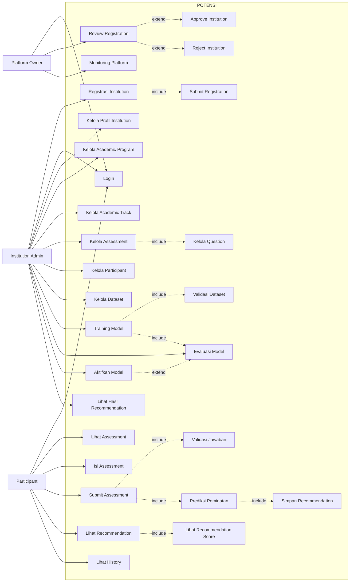
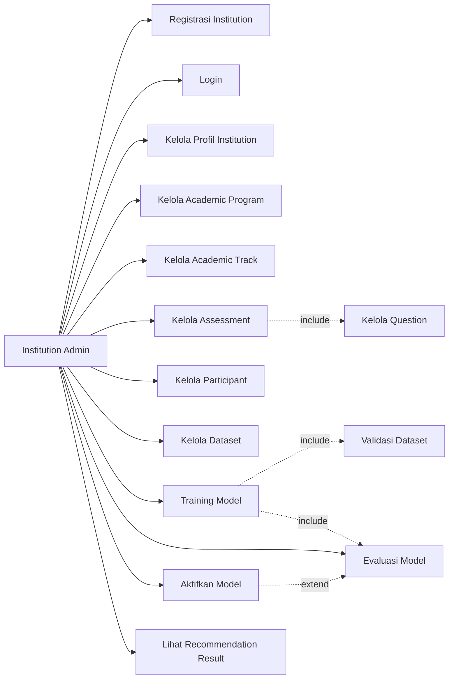
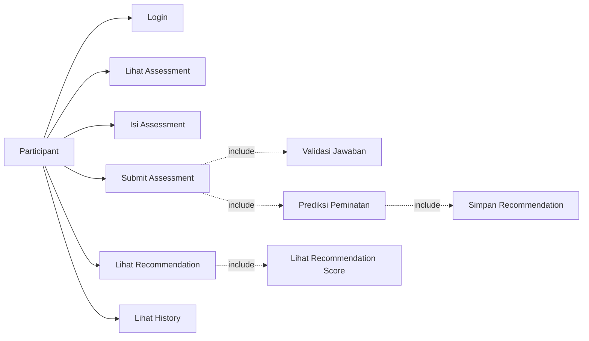
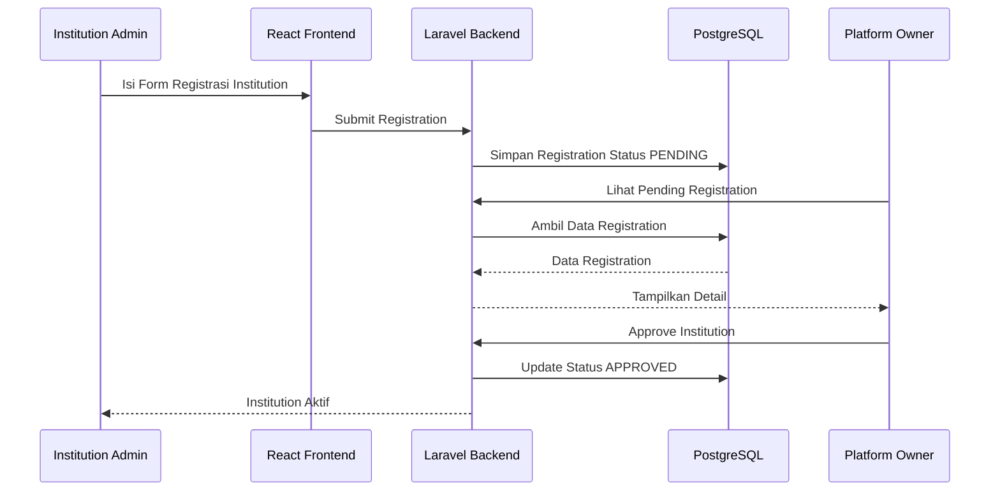
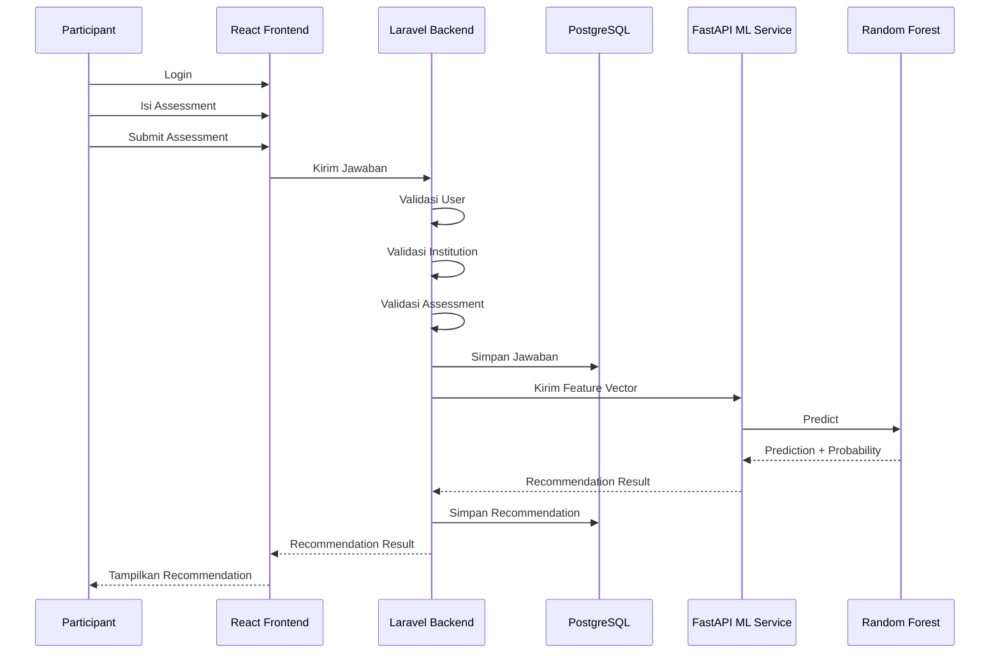

# POTENSI
## Platform Rekomendasi Peminatan Akademik Berbasis Data

**Judul Proyek:**  
Perancangan Sistem Rekomendasi Peminatan Akademik Berbasis Data Menggunakan Machine Learning

**Nama Produk:**  
**POTENSI**

**Deskripsi Produk:**  
Platform Rekomendasi Peminatan Akademik Berbasis Data

**Studi Kasus Awal:**  
Rekomendasi peminatan mahasiswa Informatika antara **Data Science** dan **Network**

---

# 1. Gambaran Umum Sistem

POTENSI adalah platform berbasis web yang membantu institusi pendidikan memberikan rekomendasi peminatan akademik kepada peserta didik berdasarkan data assessment dan Machine Learning.

Platform ini dapat digunakan oleh:

- universitas,
- sekolah,
- lembaga pendidikan,
- atau institusi pendidikan lainnya.

Pada implementasi awal, POTENSI difokuskan pada rekomendasi peminatan mahasiswa Informatika antara:

- Data Science
- Network

Namun, sistem dibuat fleksibel sehingga setiap institution dapat menentukan sendiri:

- program akademik,
- kategori peminatan,
- assessment,
- pertanyaan,
- participant,
- dataset,
- dan model rekomendasi.

---

# 2. Aktor Sistem

POTENSI memiliki tiga aktor utama.

## 2.1 Platform Owner

Platform Owner adalah pengelola utama POTENSI.

Tanggung jawab utama Platform Owner:

- login ke dashboard owner,
- melihat pengajuan pendaftaran institution,
- memeriksa informasi institution,
- menyetujui pendaftaran institution,
- menolak pendaftaran institution,
- mengaktifkan atau menonaktifkan institution jika diperlukan,
- melakukan monitoring penggunaan platform.

Platform Owner **tidak membuat institution secara manual**.

Institution melakukan pendaftaran sendiri melalui Institution Admin.

---

## 2.2 Institution Admin

Institution Admin adalah pihak dari sekolah atau universitas yang mendaftarkan institution ke POTENSI.

Contoh:

```text
Institution:
Universitas A

Institution Admin:
Admin Akademik Universitas A
```

Institution Admin bertanggung jawab untuk:

- melakukan registrasi institution,
- menunggu persetujuan Platform Owner,
- login setelah institution disetujui,
- mengelola profil institution,
- membuat academic program,
- membuat academic track,
- membuat assessment,
- membuat pertanyaan,
- membuat akun participant,
- mengelola dataset,
- melakukan training model,
- melihat hasil evaluasi model,
- mengaktifkan model,
- melihat hasil rekomendasi participant.

---

## 2.3 Participant

Participant adalah siswa atau mahasiswa yang mengikuti assessment.

Participant tidak melakukan registrasi sendiri.

Akun Participant dibuat oleh Institution Admin.

Tanggung jawab Participant:

- login,
- melihat assessment,
- mengisi assessment,
- submit assessment,
- melihat hasil rekomendasi,
- melihat histori assessment.

---

# 3. Konsep Institution Registration

Pendaftaran institution dilakukan oleh Institution Admin.

Flow:

```text
Institution Admin
       │
       ▼
Registrasi Institution
       │
       ▼
Mengisi Data Institution
       │
       ▼
Submit Registration
       │
       ▼
Status: PENDING
       │
       ▼
Platform Owner Review
       │
       ├───────────────┐
       │               │
       ▼               ▼
   APPROVED         REJECTED
       │               │
       ▼               ▼
Institution Aktif   Perbaiki Data /
       │            Daftar Kembali
       ▼
Institution Admin
dapat mengakses dashboard
```

---

# 4. Status Institution

Status institution:

```text
PENDING
APPROVED
REJECTED
INACTIVE
```

## PENDING

Institution sudah melakukan registrasi tetapi belum diperiksa oleh Platform Owner.

## APPROVED

Institution sudah disetujui dan Institution Admin dapat menggunakan fitur utama POTENSI.

## REJECTED

Pendaftaran ditolak dan Institution Admin harus memperbaiki data atau melakukan registrasi ulang.

## INACTIVE

Institution sebelumnya aktif tetapi dinonaktifkan oleh Platform Owner.

---

# 5. Business Flow Utama

```text
INSTITUTION ADMIN
      │
      ▼
Registrasi Institution
      │
      ▼
Mengisi Data Institution
      │
      ▼
Submit Pendaftaran
      │
      ▼
Status PENDING
      │
      ▼
PLATFORM OWNER
      │
      ▼
Review Pendaftaran
      │
      ├────────────────────┐
      │                    │
      ▼                    ▼
   APPROVE               REJECT
      │                    │
      ▼                    ▼
Institution Aktif      Registrasi Ditolak
      │
      ▼
INSTITUTION ADMIN
      │
      ├── Kelola Profil Institution
      ├── Membuat Academic Program
      ├── Membuat Academic Track
      ├── Membuat Assessment
      ├── Membuat Question
      ├── Membuat Akun Participant
      ├── Menyiapkan Dataset
      ├── Training Model
      ├── Evaluasi Model
      └── Mengaktifkan Model
                       │
                       ▼
                 Model Aktif
                       │
                       ▼
                  PARTICIPANT
                       │
                       ▼
                     Login
                       │
                       ▼
              Melihat Assessment
                       │
                       ▼
                Isi Assessment
                       │
                       ▼
               Submit Assessment
                       │
                       ▼
               Validasi Jawaban
                       │
                       ▼
                Feature Processing
                       │
                       ▼
              Machine Learning Model
                       │
                       ▼
                  Prediction
                       │
             ┌─────────┴─────────┐
             ▼                   ▼
       Data Science           Network
          82%                   18%
             │
             ▼
        Recommendation
             │
             ▼
       Result Dashboard
```

---

# 6. Tahapan Business Flow

## 6.1 Tahap 1 — Registrasi Institution

Institution Admin membuka POTENSI dan memilih:

```text
Daftar Institution
```

Institution Admin mengisi:

```text
Nama Institution
Jenis Institution
Alamat
Email Institution
Nomor Telepon
Nama Admin
Email Admin
Password Admin
Dokumen Pendukung jika dibutuhkan
```

Setelah submit:

```text
Registration Status = PENDING
```

---

## 6.2 Tahap 2 — Approval oleh Platform Owner

Platform Owner membuka:

```text
Pending Institution Registration
```

Platform Owner memeriksa:

- nama institution,
- jenis institution,
- kontak,
- informasi admin,
- dokumen pendukung jika ada.

Platform Owner kemudian memilih:

```text
APPROVE
```

atau:

```text
REJECT
```

Jika approve:

```text
Institution Status = APPROVED
```

Institution Admin dapat login dan menggunakan dashboard institution.

---

# 7. Flow Setelah Institution Disetujui

Setelah status institution:

```text
APPROVED
```

Institution Admin dapat melakukan setup sistem.

```text
Institution Admin
       │
       ▼
Login
       │
       ▼
Dashboard Institution
       │
       ├── Academic Program
       ├── Academic Track
       ├── Assessment
       ├── Question
       ├── Participant
       ├── Dataset
       └── Machine Learning Model
```

---

# 8. Academic Program dan Track

Contoh:

```text
Institution:
Universitas A

Academic Program:
Peminatan Informatika

Academic Track:
├── Data Science
└── Network
```

Academic Track merupakan kategori hasil rekomendasi.

---

# 9. Assessment Setup

Institution Admin membuat assessment.

Contoh:

```text
Assessment:
Assessment Peminatan Informatika
```

Contoh pertanyaan:

```text
Saya tertarik melakukan analisis data.
1 2 3 4 5

Saya tertarik menggunakan bahasa pemrograman.
1 2 3 4 5

Saya tertarik mempelajari Machine Learning.
1 2 3 4 5

Saya tertarik mempelajari jaringan komputer.
1 2 3 4 5

Saya tertarik mengelola server dan infrastruktur.
1 2 3 4 5
```

---

# 10. Pembuatan Akun Participant

Participant tidak melakukan registrasi sendiri.

Institution Admin membuat akun Participant.

Flow:

```text
Institution Admin
       │
       ▼
Menu Participant
       │
       ▼
Tambah Participant
       │
       ▼
Isi Data Participant
       │
       ▼
Akun Participant Dibuat
       │
       ▼
Participant Mendapatkan Akses Login
```

Contoh participant:

```text
Nama:
Mahasiswa A

Email:
mahasiswa@example.com

Role:
Participant

Institution:
Universitas A
```

---

# 11. Dataset dan Training Model

Institution Admin menyiapkan dataset.

Contoh:

| Programming | Data Analysis | AI Interest | Networking | Infrastructure | Label |
|---:|---:|---:|---:|---:|---|
| 5 | 5 | 5 | 2 | 1 | Data Science |
| 2 | 1 | 1 | 5 | 5 | Network |
| 4 | 5 | 4 | 2 | 2 | Data Science |
| 2 | 2 | 1 | 5 | 4 | Network |

Flow:

```text
Dataset
   ↓
Validasi Dataset
   ↓
Training Model
   ↓
Evaluasi Model
   ↓
Model Ready
   ↓
Aktifkan Model
```

Metode Machine Learning:

> **Random Forest Classifier**

---

# 12. Flow Participant

Setelah:

```text
Institution = APPROVED
Model       = ACTIVE
Assessment  = PUBLISHED
Participant = ACTIVE
```

Participant dapat melakukan assessment.

Flow:

```text
Participant
    │
    ▼
Login
    │
    ▼
Melihat Assessment
    │
    ▼
Mengisi Assessment
    │
    ▼
Submit Assessment
    │
    ▼
Validasi Jawaban
    │
    ▼
Machine Learning Prediction
    │
    ▼
Recommendation Result
    │
    ▼
Participant Melihat Hasil
```

---

# 13. Use Case Diagram Utama



---

# 14. Deskripsi Use Case Platform Owner

| Kode | Use Case | Deskripsi |
|---|---|---|
| UC-PO-01 | Login | Platform Owner masuk ke dashboard POTENSI |
| UC-PO-02 | Review Registration | Melihat dan memeriksa pengajuan institution |
| UC-PO-03 | Approve Institution | Menyetujui institution agar dapat menggunakan POTENSI |
| UC-PO-04 | Reject Institution | Menolak pengajuan institution |
| UC-PO-05 | Monitoring Platform | Melihat statistik dan aktivitas penggunaan platform |

---

# 15. Detail Use Case Approval Institution

## UC-PO-02 — Review Registration

**Actor:** Platform Owner

**Tujuan:**  
Memeriksa institution yang mendaftar ke POTENSI.

**Precondition:**

```text
Institution Status = PENDING
```

**Alur Utama:**

1. Platform Owner login.
2. Owner membuka menu Institution Registration.
3. Sistem menampilkan daftar institution dengan status PENDING.
4. Owner membuka detail pengajuan.
5. Owner memeriksa informasi institution.
6. Owner memilih Approve atau Reject.

---

## UC-PO-03 — Approve Institution

**Actor:** Platform Owner

**Alur:**

```text
Pending Registration
       ↓
Review
       ↓
Approve
       ↓
Institution Status = APPROVED
       ↓
Institution Admin dapat Login
       ↓
Dashboard Institution Aktif
```

---

## UC-PO-04 — Reject Institution

Jika data tidak sesuai:

```text
Pending Registration
       ↓
Review
       ↓
Reject
       ↓
Institution Status = REJECTED
```

Institution Admin dapat memperbaiki atau melakukan pendaftaran ulang sesuai kebijakan sistem.

---

# 16. Deskripsi Use Case Institution Admin

| Kode | Use Case | Deskripsi |
|---|---|---|
| UC-IA-01 | Registrasi Institution | Admin sekolah/universitas mengajukan institution ke POTENSI |
| UC-IA-02 | Login | Login setelah institution disetujui |
| UC-IA-03 | Kelola Profil Institution | Mengelola data institution |
| UC-IA-04 | Kelola Academic Program | Membuat program akademik/peminatan |
| UC-IA-05 | Kelola Academic Track | Menentukan pilihan peminatan |
| UC-IA-06 | Kelola Assessment | Membuat dan mengatur assessment |
| UC-IA-07 | Kelola Question | Membuat pertanyaan assessment |
| UC-IA-08 | Kelola Participant | Membuat akun siswa atau mahasiswa |
| UC-IA-09 | Kelola Dataset | Menyiapkan data training |
| UC-IA-10 | Training Model | Melatih Random Forest |
| UC-IA-11 | Evaluasi Model | Melihat kualitas model |
| UC-IA-12 | Aktifkan Model | Mengaktifkan model untuk prediction |
| UC-IA-13 | Lihat Recommendation Result | Melihat hasil recommendation participant |

---

# 17. Use Case Institution Admin



---

# 18. Deskripsi Use Case Participant

| Kode | Use Case | Deskripsi |
|---|---|---|
| UC-PT-01 | Login | Participant masuk menggunakan akun dari institution |
| UC-PT-02 | Lihat Assessment | Melihat assessment aktif |
| UC-PT-03 | Isi Assessment | Menjawab seluruh pertanyaan |
| UC-PT-04 | Submit Assessment | Mengirim jawaban |
| UC-PT-05 | Validasi Jawaban | Sistem memastikan jawaban lengkap |
| UC-PT-06 | Prediksi Peminatan | Sistem memproses jawaban dengan model |
| UC-PT-07 | Simpan Recommendation | Sistem menyimpan hasil prediksi |
| UC-PT-08 | Lihat Recommendation | Participant melihat hasil rekomendasi |
| UC-PT-09 | Lihat Recommendation Score | Participant melihat skor tiap track |
| UC-PT-10 | Lihat History | Melihat histori assessment |

---

# 19. Use Case Participant



---

# 20. End-to-End Business Flow

```text
Institution Admin
       │
       ▼
Register Institution
       │
       ▼
Submit Registration
       │
       ▼
Status PENDING
       │
       ▼
Platform Owner Review
       │
       ▼
APPROVED
       │
       ▼
Institution Admin Login
       │
       ▼
Setup Institution
       │
       ├── Academic Program
       ├── Academic Track
       ├── Assessment
       ├── Question
       ├── Participant
       └── Dataset
               │
               ▼
          Training Model
               │
               ▼
          Evaluasi Model
               │
               ▼
           Model Aktif
               │
               ▼
        Participant Login
               │
               ▼
        Isi Assessment
               │
               ▼
       Submit Assessment
               │
               ▼
        Machine Learning
               │
               ▼
         Recommendation
               │
               ▼
        Result Dashboard
```

---

# 21. End-to-End System Flow

```text
Participant
    │
    ▼
React Frontend
    │
    │ Submit Assessment
    ▼
Laravel Backend
    │
    ├── Validasi User
    ├── Validasi Institution
    ├── Validasi Assessment
    ├── Simpan Jawaban
    └── Bentuk Feature Vector
              │
              ▼
       FastAPI ML Service
              │
              ▼
      Random Forest Model
              │
              ▼
     Prediction + Score
              │
              ▼
        Laravel Backend
              │
              ├── Simpan Recommendation
              └── Simpan Score
              │
              ▼
        PostgreSQL Database
              │
              ▼
        Laravel Response
              │
              ▼
         React Frontend
              │
              ▼
       Recommendation Result
```

---

# 22. Sequence Flow Registrasi Institution



---

# 23. Sequence Flow Submit Assessment



---

# 24. Arsitektur Integrasi

```text
┌──────────────────────────────┐
│          FRONTEND            │
│      React + TypeScript      │
└──────────────┬───────────────┘
               │
               │ REST API
               ▼
┌──────────────────────────────┐
│           BACKEND            │
│           Laravel            │
│                              │
│ Authentication               │
│ Authorization                │
│ Institution Registration     │
│ Approval Process             │
│ Assessment Management        │
│ Participant Management       │
│ Recommendation Process       │
└──────────────┬───────────────┘
               │
       ┌───────┴─────────┐
       │                 │
       ▼                 ▼
 PostgreSQL         FastAPI ML Service
 Database                 │
                          ▼
                 Random Forest Model
                          │
                          ▼
                      Prediction
```

---

# 25. Ringkasan Hak Akses

| Fitur | Platform Owner | Institution Admin | Participant |
|---|---:|---:|---:|
| Registrasi Institution | Tidak | Ya | Tidak |
| Review Registration | Ya | Tidak | Tidak |
| Approve / Reject Institution | Ya | Tidak | Tidak |
| Monitoring Platform | Ya | Tidak | Tidak |
| Kelola Profil Institution | Tidak | Ya | Tidak |
| Kelola Academic Program | Tidak | Ya | Tidak |
| Kelola Academic Track | Tidak | Ya | Tidak |
| Kelola Assessment | Tidak | Ya | Tidak |
| Kelola Question | Tidak | Ya | Tidak |
| Kelola Participant | Tidak | Ya | Tidak |
| Kelola Dataset | Tidak | Ya | Tidak |
| Training Model | Tidak | Ya | Tidak |
| Aktifkan Model | Tidak | Ya | Tidak |
| Isi Assessment | Tidak | Tidak | Ya |
| Lihat Recommendation | Monitoring | Ya | Ya |

---

# 26. Kesimpulan

Alur bisnis POTENSI dimulai dari Institution Admin, bukan Platform Owner.

Flow utama:

```text
Institution Admin
      ↓
Registrasi Institution
      ↓
Platform Owner Review
      ↓
Approve
      ↓
Institution Admin Setup Sistem
      ↓
Buat Participant
      ↓
Buat Assessment
      ↓
Training Model
      ↓
Participant Isi Assessment
      ↓
Machine Learning Prediction
      ↓
Recommendation
```

Platform Owner hanya berfungsi sebagai:

```text
Approval
Monitoring
Control Institution Status
```

Institution Admin merupakan pengelola utama seluruh proses akademik di institution.

Participant hanya menggunakan sistem untuk:

```text
Login
Assessment
Recommendation
History
```

Prinsip utama POTENSI:

> **Institution Registration → Approval → Assessment Setup → Machine Learning → Recommendation**
